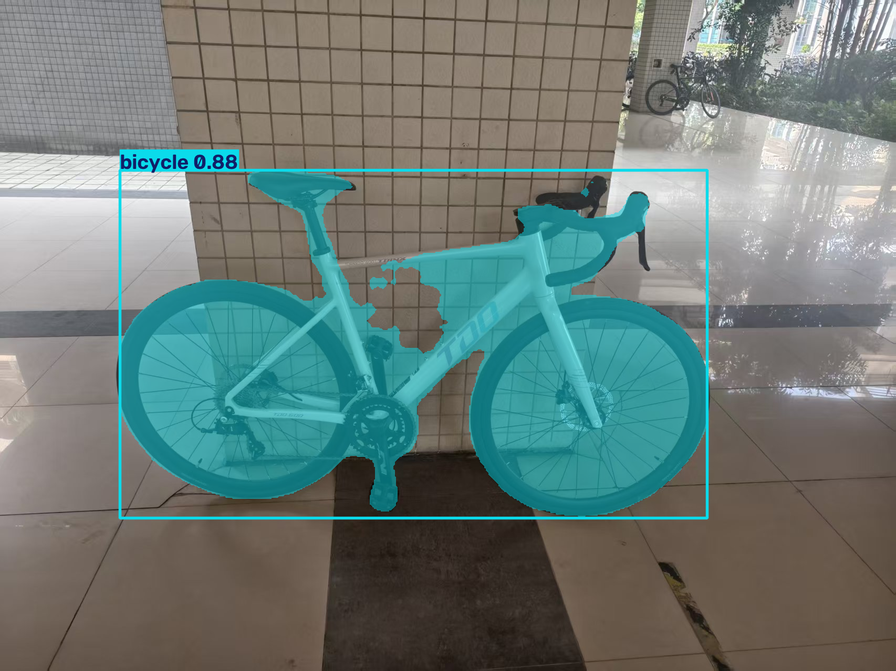
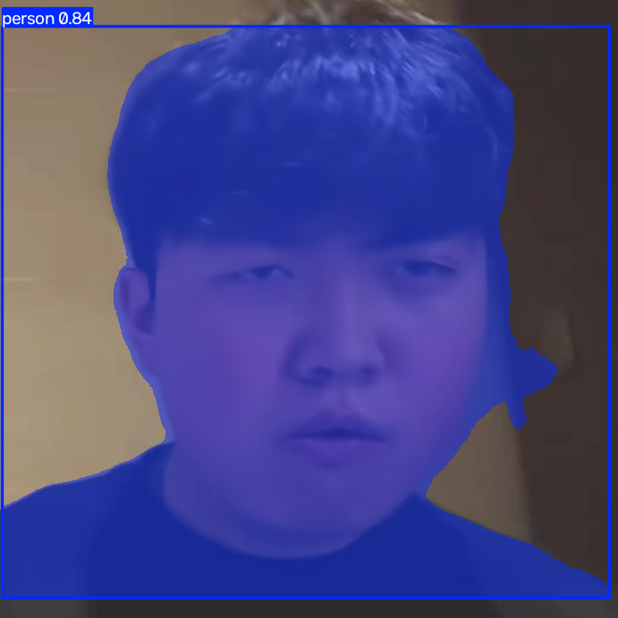
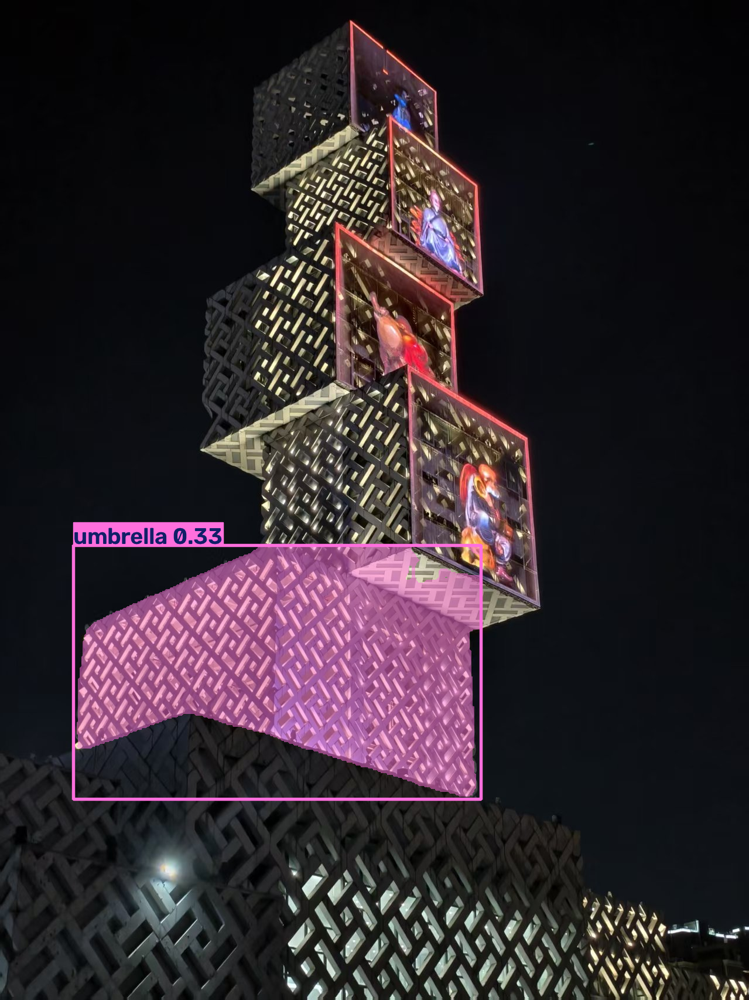

# YOLOv8 图像分割 Demo

基于 [Ultralytics YOLOv8](https://docs.ultralytics.com/) 的实例分割实践项目：批量推理、按目标裁剪、置信度阈值对比实验，并附带一个 Gradio 网页界面。

## 效果预览

| 自行车（yolov8n-seg） | 人像 | 建筑夜景（误检为 umbrella） |
|---|---|---|
|  |  |  |

## 快速开始

```bash
# 1. 建虚拟环境
python -m venv .venv
# Windows
.\.venv\Scripts\Activate.ps1
# macOS / Linux
source .venv/bin/activate

# 2. 装依赖
pip install -r requirements.txt

# 3. 运行
python app.py      # 网页界面，浏览器打开 http://127.0.0.1:7860
python demo.py     # 批量处理 ./input 下的图片，输出到 ./output
```

> **需要 GPU 的话**：`requirements.txt` 里装的是 CPU 版 torch。想用显卡加速，先单独装 CUDA 版本：
> ```bash
> pip install torch torchvision --index-url https://download.pytorch.org/whl/cu128
> ```
> `cu128` 及以上是 RTX 50 系（Blackwell / sm_120）的必需项，装旧版会报 `no kernel image is available`。

首次运行会自动下载模型权重 `yolov8n-seg.pt`（约 6.7 MB），之后走本地缓存。

## 用法

```bash
# 默认：读 ./input，写 ./output，conf=0.25，yolov8n-seg
python demo.py

# 指定输入目录
python demo.py --source 我的照片

# 提高置信度阈值，只保留更确定的目标
python demo.py --conf 0.5

# 换更大的模型（更准，更慢）
python demo.py --model yolov8s-seg.pt
```

输出：

- `output/vis/` —— 每张图带掩码的可视化结果
- `output/objects/` —— 每个目标单独裁出，背景置黑

## 文件说明

| 文件 | 说明 |
|---|---|
| `app.py` | Gradio 网页界面：上传图片、实时调节阈值、显示掩码与统计 |
| `demo.py` | 批量处理脚本：批量推理、按目标裁剪、统计目标数量 |
| `requirements.txt` | 依赖清单 |
| `samples/` | 运行结果截图 |
| `.gitignore` | 已排除虚拟环境、权重文件与运行产物 |

## 实验结论

在一个 RTX 5060（8 GB）环境上，用 3 张自采图片做了两组对比实验：

1. **模型规模**：yolov8n-seg（3.4M 参数）平均 58.5 ms/张，yolov8s-seg（11.8M 参数）67.6 ms/张。
   类别在预训练类别表内时，大模型带来真实提升（自行车从检出 1 辆变为 2 辆）。
2. **类别缺失**：建筑夜景被识别为 `umbrella`（0.33），换大模型后变成 `clock`（0.54）。
   模型并未改善，只是**更自信地犯错**——COCO 80 类里没有"建筑"，换更大的模型也突破不了这个限制。
3. **置信度阈值**：0.25 / 0.50 / 0.90 对应检出 3 / 2 / 0 个目标。阈值升高会同时压制误检与真目标；
   对 `clock 0.54` 这一例，阈值 0.5 依然过滤不掉，说明**调参解决不了错误类别**。

完整数据与失败分析见 `日志.md`。

## 运行环境

| 项目 | 版本 |
|---|---|
| Python | 3.12.10 |
| PyTorch | 2.11.0+cu128 / torchvision 0.26.0+cu128 |
| ultralytics | 8.4.211 |
| GPU | NVIDIA RTX 5060 Laptop（8 GB, sm_120） |

## 已知问题

- **掩码泄漏**：自行车图中，车架三角区域内的背景墙被计入掩码。把背景从黑色改为白色后更易观察。
- **首图计时异常**：每轮运行的第一张图耗时 13–15 ms，后两张 70–115 ms。怀疑与 GPU 降频或
  CUDA 异步计时有关，尚未验证。
- 仅支持 COCO 80 类，超出范围的物体不会得到正确结果。

## 参考

- [Ultralytics 文档](https://docs.ultralytics.com/)
- [YOLOv8 论文](https://arxiv.org/abs/2305.09972)
